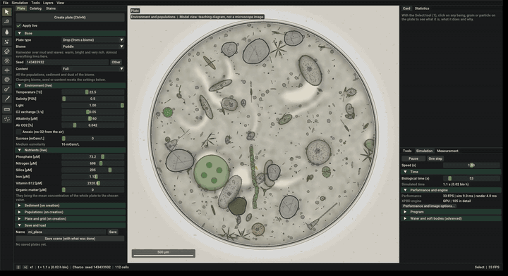

<h1 align="center">Open Microcosm</h1>

<p align="center">
  <strong>An open-source virtual microscope laboratory where real microscopic life emerges from physics.</strong>
</p>

<p align="center">
  <a href="LICENSE"></a>
  
  
  
</p>

<p align="center">
  
</p>

Open Microcosm simulates microscopic life **as it is seen through a laboratory microscope**: drops of water
with their microorganisms, **cell cultures** (human and animal cells on a dish) and **plant
preparations** (tissues with cell walls). Cells are gelatinous, semi-transparent bodies with visible
organelles. They swim or crawl, eat, grow, divide, conjugate, die and lyse, and **all of it emerges
from a physical particle simulation, not from animations**.

It is a **research and teaching tool**, not a game: there is no score and no victory. You prepare a
plate, observe it and intervene.

- **Research:** complex, reproducible and measurable simulations (time series, mass budgets, export
  with provenance, replicates), also **headless** (`microcosm_bench`, `microcosm_batch`).
- **Teaching:** show students what happens, with the microscope image, inspector cards that explain
  what each thing is and why, and guided lessons.

## Screenshots

<table>
  <tr>
    <td></td>
    <td></td>
  </tr>
  <tr>
    <td align="center">A pond drop: ciliates, diatoms, algae and bacteria</td>
    <td align="center">Cell culture: human fibroblasts migrating in DMEM</td>
  </tr>
  <tr>
    <td></td>
    <td></td>
  </tr>
  <tr>
    <td align="center">Onion epidermis plasmolysing in salt water</td>
    <td align="center">Semen analysis with CASA kinematics</td>
  </tr>
  <tr>
    <td colspan="2"></td>
  </tr>
  <tr>
    <td colspan="2" align="center">The laboratory: dockable panels for the plate, catalogue, stains, statistics and plots</td>
  </tr>
</table>

## Features

- **Real organisms only.** 92 beings in the factory pack: ciliates, flagellates, amoebae, diatoms,
  desmids, colonial and filamentous algae, dinoflagellates, yeasts, human cell lines and blood cells,
  plant cells and the human spermatozoon, plus bacteria, cyanobacteria, fungi, phages and *Physarum*.
  Every measured value carries its published source. See the [catalogue](docs/content/beings/README.md).
- **Physics first.** Inertia-free soft bodies (XPBD), exact Stokes–Brinkman water at low Reynolds
  number, diffusing chemistry (O₂, CO₂/pH, P, N, Si, Fe, B₁₂…), Beer–Lambert light.
- **Real biology.** Respiration, fermentation and photosynthesis with Droop quotas and Liebig's law;
  physical phagocytosis; mitosis, conjugation, cysts and budding; a mutating genome; behaviour such as
  the avoiding reaction, phototaxis, chemotaxis and jumps; induced defences and chemical signals.
- **Laboratory plates.** Pond drops from six real biomes, cell culture in an incubator, slides
  (onion, *Elodea*, potato with Lugol, root tip, blood smear, buccal mucosa, fresh semen) and a
  well-mixed culture for millilitre-scale experiments (Gause, Tilman, chemostats).
- **Measurement.** Live plots, mass budgets that close, growth-curve fitting, regions, CASA, CSV/JSON
  export with provenance, photos with a scale bar and time-lapses by biological time.
- **Reproducibility.** Deterministic by seed; every intervention is recorded, and a scene replays
  bit for bit on the same binary and machine. Batch experiments with replicates and 95 % CIs.
- **Teaching.** Lessons as protocols with tested solutions, a glossary, notes anchored to beings,
  and real stains (Gram, Lugol, DAPI, Giemsa, neutral red, eosin–nigrosin, trypan blue…).
- **Content as data.** Beings, biomes, media, plates and lessons are TOML files; anyone can add
  organisms in a content pack without touching C++.
- **Validated** against published results: see [validation](docs/validation/README.md).

## Installation

There are no published releases yet: build from source. Every dependency (raylib, Dear ImGui,
ImPlot, EnTT, toml++, doctest, Tracy) is downloaded automatically by CMake (`FetchContent`) at a fixed
version; only a C++20 compiler with **OpenMP**, **CMake ≥ 3.24**, **Ninja** and Git are needed. The
first configuration needs an internet connection.

Hardware: an OpenGL 4.3 GPU (for the optional GPU physics engine) and a multi-core CPU.

### Linux

Debian / Ubuntu:

```sh
sudo apt install build-essential cmake ninja-build git \
    libx11-dev libxrandr-dev libxinerama-dev libxcursor-dev libxi-dev libgl1-mesa-dev
```

Fedora:

```sh
sudo dnf install gcc-c++ cmake ninja-build git \
    libX11-devel libXrandr-devel libXinerama-devel libXcursor-devel libXi-devel mesa-libGL-devel
```

Arch:

```sh
sudo pacman -S base-devel cmake ninja git libx11 libxrandr libxinerama libxcursor libxi mesa
```

Then:

```sh
git clone <repository-url> open-microcosm
cd open-microcosm
cmake --preset release
cmake --build --preset release
./build/release/microcosm
```

### Windows

The Windows package is **cross-compiled from Linux** with MinGW-w64 (this is the tested route):

```sh
sudo apt install mingw-w64          # on the Linux build machine
cmake --preset windows
cmake --build --preset windows
cd build/windows && cpack           # OpenMicrocosm-<version>-Windows.zip
```

Building natively on Windows uses the same compiler through [MSYS2](https://www.msys2.org/). In the
*MSYS2 UCRT64* shell:

```sh
pacman -S --needed git mingw-w64-ucrt-x86_64-gcc mingw-w64-ucrt-x86_64-cmake mingw-w64-ucrt-x86_64-ninja
git clone <repository-url> open-microcosm
cd open-microcosm
cmake --preset release
cmake --build --preset release
./build/release/microcosm.exe
```

MSVC is not tested.

### macOS (not tested, community supported)

macOS has **not been tested** by the maintainers, who have no Mac to test on. It is supported on a
best-effort basis by the community: reports and pull requests are very welcome. Known obstacles:

- **OpenMP:** Apple clang does not ship it. Use Homebrew's LLVM, or Apple clang with `libomp`.
- **OpenGL:** macOS stops at OpenGL 4.1, while Open Microcosm requests a 4.3 context for its GPU compute
  shaders (`OPENGL_VERSION` in `CMakeLists.txt`). Without compute shaders the CPU engine is used, but
  the window may fail to open until a 3.3 fallback is added.
- **`-march=native`:** may not be accepted on Apple Silicon; configure with `-DBIO_NATIVE=OFF`.

Expected steps:

```sh
brew install cmake ninja git llvm libomp
git clone <repository-url> open-microcosm
cd open-microcosm
cmake --preset release -DBIO_NATIVE=OFF \
    -DCMAKE_C_COMPILER="$(brew --prefix llvm)/bin/clang" \
    -DCMAKE_CXX_COMPILER="$(brew --prefix llvm)/bin/clang++"
cmake --build --preset release
./build/release/microcosm
```

### Build presets

| Preset | Use |
|---|---|
| `release` | Optimised build for your machine (`-march=native`, `-ffast-math`). |
| `debug` | Debug build. |
| `profile` | RelWithDebInfo with the Tracy profiler. |
| `lite` | Per-scope timings without Tracy (`microcosm_bench` prints them). |
| `dist` | Linux distribution build (x86-64-v2, static runtime); `cpack` builds the `.tar.gz`. `tools/paquete-linux.sh` builds it in a Docker container with glibc 2.35. |
| `windows` | Cross-compiled Windows build with MinGW-w64. |

`-DBIO_STRICT_FP=ON` disables `-ffast-math` so that `microcosm_bench` checksums of two versions can be
compared.

## Usage

The program opens directly in the laboratory with an **empty Petri dish**. Prepare it in the
**Plate** panel (biome and seed, content, environment, nutrients, populations or a prepared plate)
and create it with **Create plate** (Ctrl+N). Environment and nutrients change live.

| Action | How |
|---|---|
| Select a being and open its card | Click (Select tool, the default) |
| Control a being | Control tool or `P` over a cell; flagellates and amoebae with the mouse, ciliates with W/A/S/D |
| Tools | Left toolbar or keys 1–0, M and G: ink, detritus, erase, lyse, squeeze, stir, stretch, dropper, measure, region, spawn |
| Inoculate any being | Catalogue > Inoculate… |
| Stain or fix the sample | Stains panel |
| Plots, budgets, CASA, lessons, cultures, experiments | *View* menu |
| Zoom / pan / pause | Mouse wheel / right-button drag / Space |
| Export data | Ctrl+E (CSV and JSON with provenance) |
| Save a scene (plate + interventions) | Plate panel > *Save scene* |

The interface is in Spanish and English (Preferences). User data lives in the platform's data folder
under `openmicrocosm/` (plates, scenes, cultures, experiments, stains, photos, exports, packs).

### Headless

```sh
./build/release/microcosm_bench --biome pond --seed 66 --steps 600    # ms/step, census, checksum
./build/release/microcosm_bench --timelapse 10 --steps 36000          # a photo every 10 biological minutes
./build/release/microcosm_bench --casa                                # sperm kinematics
./build/release/microcosm_batch experiment.toml --salida results/      # replicates and factors
```

## Testing

```sh
ctest --test-dir build/release -L rapidos            # fast suite, ~2 min
ctest --test-dir build/release -L largos -j8         # long cases, ~16 min
ctest --test-dir build/release -L validacion -j4     # against published results, ~28 min
tools/ci.sh                                          # local CI: build without warnings, docs, fast tests
```

## Documentation

All documentation is in [`docs/`](docs/README.md):

- [Mechanics](docs/mechanics/README.md): one document per mechanism of the simulator.
- [Content format](docs/content/README.md) and [one document per being](docs/content/beings/README.md).
- [Validation](docs/validation/README.md) against the literature.
- [Known bugs](docs/bugs/README.md) and [roadmap](docs/roadmap.md).
- [`AGENTS.md`](AGENTS.md): architecture, rules and the documentation policy, for humans and AI agents.

## Contributing

Contributions are welcome: new organisms, mechanisms, lessons, translations, validation against
published experiments, bug reports and fixes. Read [`CONTRIBUTING.md`](CONTRIBUTING.md) and
[`AGENTS.md`](AGENTS.md) first. The guiding principle is **strict realism**: only real species and
mechanisms, and every measured value with its source.

### Vibe-coding policy

**Vibe coding is completely allowed.** You may write your contribution with AI assistants or coding
agents (Claude Code, Copilot, Cursor, or any other), in whole or in part. `AGENTS.md` is written so
that agents can work on the code base directly.

AI-written contributions are held to exactly the same standard as any other:

- the code builds **without warnings** and the tests pass (`tools/ci.sh`);
- biological data and mechanisms are **real and sourced** (check the reference yourself: models do
  invent citations);
- the documentation is updated as `AGENTS.md` requires;
- you understand and stand behind what you submit, and you have the right to license it under the
  GPL.

Saying in the pull request that an AI helped is appreciated but optional.

## Citing

If you use Open Microcosm in research or teaching, please cite it: see [`CITATION.cff`](CITATION.cff) (GitHub
shows a "Cite this repository" button).

## License

Open Microcosm is free software: you can redistribute it and/or modify it under the terms of the **GNU
General Public License, version 3 or (at your option) any later version** (`GPL-3.0-or-later`). The
full text is in [`LICENSE`](LICENSE).

This is a **copyleft** licence: anyone who distributes Open Microcosm or a modified version must offer the
complete corresponding source code under the same licence. Contributions are accepted under the same
terms.

Third-party components keep their own compatible licences, installed in `licenses/` next to the
executable: raylib and GLFW (zlib), Dear ImGui, ImPlot, EnTT and toml++ (MIT), doctest (MIT), Tracy
(BSD-3-Clause, only in the `profile` preset) and the Roboto font (Apache 2.0). A new dependency or
asset must have a GPLv3-compatible licence.

Open Microcosm is distributed in the hope that it will be useful, but **without any warranty**; it is a
research and teaching simulator and must not be used for medical diagnosis.
